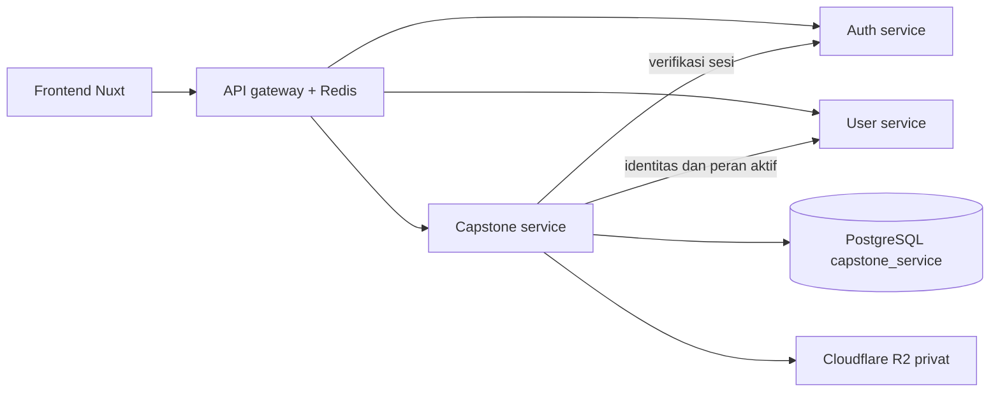

# Batas layanan dan pengoperasian

Capstone service mengelola proses akademik dari pendaftaran judul sampai pemeriksaan berkas UP. Layanan ini memiliki database/schema sendiri dan diakses lewat API gateway. Password/sesi dimiliki auth service, sedangkan akun/peran dimiliki user service. Tidak ada query atau foreign key lintas database.



Pembagian berdasarkan domain bisnis dan kepemilikan data ini mengikuti prinsip [bounded context dan private data per service](https://learn.microsoft.com/en-us/azure/architecture/guide/architecture-styles/microservices). Modul bimbingan, penetapan, dan persyaratan UP masih berbagi aturan proyek serta mahasiswa, sehingga berada dalam batas akademik yang sama. Ini keputusan untuk lingkup saat ini, bukan pernyataan bahwa semua proses kampus harus masuk layanan ini. Ujian, publikasi, atau RAG dapat dipisahkan saat memiliki aturan, data, dan kebutuhan operasional yang mandiri.

## Modul

| Modul | Data/tindakan |
| --- | --- |
| Pendaftaran | projects, interest_fields, deskripsi yang disahkan, anggota dan calon pembimbing |
| Penetapan | project_students menyatukan mahasiswa dengan posisi calon/pembimbing 1/2; dua keputusan independen |
| Bimbingan | guidance_logs individu, pemeriksaan dosen, cetak satu/seluruh log |
| Proposal | proposal_applications, screenshot SIMAK dan surat persetujuan, validasi terpisah oleh TU |
| Berkas | files berisi metadata; objek privat di storage lokal/R2 |
| Ringkasan | GET /api/v1/capstone/dashboard, agregat sesuai peran dari database layanan ini |
| Audit | audit_logs, ditulis dalam transaksi perubahan akademik |

Rute berada di `internal/httpapi/server.go`. Middleware memverifikasi cookie melalui auth service lalu membaca peran/status terkini dari user service. Penetapan, keputusan, dan pembaruan menggunakan versi optimistis dan transaksi lokal. Identitas mahasiswa/dosen tetap pada satu tabel users di layanan pengguna. ID lintas layanan adalah UUID; nama/NIM yang disimpan pada detail merupakan snapshot.

## Konfigurasi

Salin `.env.example` menjadi `.env`, isi DATABASE_URL runtime serta URL/token internal auth dan user. Gunakan role database yang dibatasi pada schema capstone, bukan kredensial owner. Migrasi dijalankan operator/penyiapan infrastruktur; aplikasi runtime tidak menjalankan DDL otomatis.

STORAGE_DRIVER=local menyimpan objek pada UPLOAD_DIR. STORAGE_DRIVER=r2 memakai R2_ACCOUNT_ID, R2_BUCKET, R2_ACCESS_KEY_ID, R2_SECRET_ACCESS_KEY. [SDK S3 Cloudflare](https://developers.cloudflare.com/r2/examples/aws/aws-sdk-go/) memakai Access Key ID dan Secret Access Key. Cloudflare API token bukan pengganti kredensial S3 tersebut dan tidak diperlukan pada runtime ini.

```powershell
go run -buildvcs=false ./cmd/api
go run -buildvcs=false ./cmd/check-integrations
go test ./...
go vet ./...
```

Pemeriksaan integrasi membaca metadata database dan membuat satu objek storage sintetis, membaca, lalu menghapusnya. Tambahkan `--storage-only` untuk memeriksa storage tanpa database. Jangan menerapkan SQL monolit referensi langsung; gunakan migrasi versi layanan. Dockerfile dan Dockerfile.dev tersedia untuk integrasi Compose di repositori infrastruktur.

Endpoint dashboard tidak mengambil tabel dari layanan lain. Dashboard admin mengambil statistik akun melalui API user service di frontend. Redis dimiliki lapisan gateway sebagai pembatas permintaan, bukan sumber keputusan akademik.
